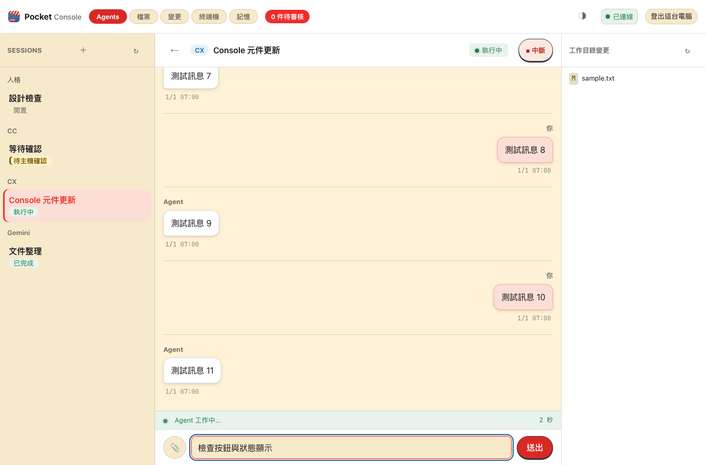
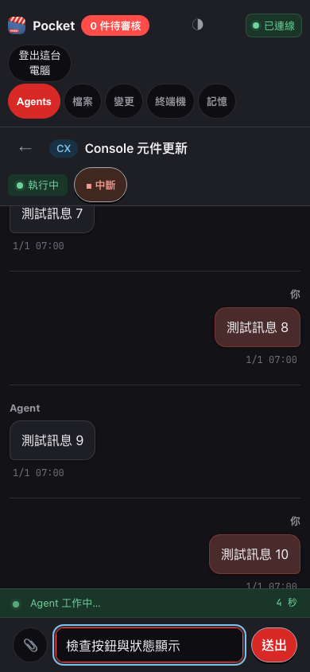

# Console 互動視覺更新

2026-11-19。沿用 Pocket 品牌與既有工作台結構，加入官網／Pocket Design 的互動層。本 PR 尚未部署，不要求資料遷移。

## 實作範圍

- `interaction.css` 加在既有 stylesheet 後：主要／危險／審批命令鈕有 1px 細框與 2px 底影；ghost、導航、連結維持平面。
- 狀態標籤使用薄荷、淡藍、琥珀、淡桃色底；燈號保留文字，執行中才脈動。
- 所有動作保持原 selector／事件處理。沒有改動 app.js、歷史、游標、SSE、審批或草稿邏輯。
- 字體只更新 code／metadata 為 JetBrains Mono，保留中文 fallback 與正文系統字。字體以 `font-display:optional` 避免延遲換字造成閱讀位置位移。
- 同站提供 JetBrains Mono 2.304 Regular／SemiBold 與 OFL 授權；沒有外部 CDN。CSP 僅新增 `font-src 'self'`，其餘門禁不放寬。
- service worker 靜態清單升為 v18，加入 stylesheet 與字體；仍不快取登入頁、HTML 導航或私人工作內容。
- 三主題、320／390／1366px、按壓／禁用／鍵盤焦點、Reduce Motion 均有瀏覽器驗證。

不修改 53-role 規範、品牌紅、既有四階陰影樣張或正式服務設定。視覺來源：[參考頁](https://designed-to-scale.vercel.app/)、[Pocket Design](https://design.pocketone.app/)。字體來源：[JetBrains Mono](https://github.com/JetBrains/JetBrainsMono/tree/v2.304)。

## 驗證與發布界線

Python 的資產、CSP、登入 cookie、公網與借用權限測試 50 項通過，bridge.py 編譯通過。瀏覽器以隔離假資料驗證，沒有讀取真人對話或送出正式操作。

兩輪 Node 測試分別為 11 通過／4 條件跳過，以及 60 通過／4 失敗。新增樣式／CSP 字體測試、狀態、閱讀位置、輸入法、工作台、操作選單測試通過。4 個失敗在未修改的 `5790143` 主線上以同一引擎也逐一重現，故不標示為全綠，也不擴大這個設計 PR 去修改工作流：

| 既有測試 | 基準與本分支共同失敗點 |
| --- | --- |
| lost HTTP acknowledgement | 等待「確認送達」按鈕超時 |
| next question shares an approval ID | 等待舊格式 `opt0. Option 0` 超時 |
| approval expires on screen | 等待 pending-list 測試工作超時 |
| borrowed browser locks on failure | 離線導航後等待「離線中」文字超時 |

第一輪 4 項跳過為需明確開啟的真人 reading pilot／standalone PWA 測試，未以正式 session 補跑。正式發布前應另輪修正或更新這些基準測試並完成真機／relay 驗收。

```bash
PYTHONPYCACHEPREFIX=/tmp/pocket-design-pycache python -m py_compile bridge.py
python -m pytest -q tests/test_console_interaction_assets.py tests/test_console_web_entry.py \
  tests/test_console_cookie_gate.py tests/test_console_remote_scope.py tests/test_console_borrowed_browser.py
node --test --test-concurrency=1 tests/browser/console-interaction.cjs \
  tests/browser/console-state.cjs tests/browser/console-mobile.cjs tests/browser/console-ops.cjs
```

Playwright 預設 Chrome。需要隔離引擎時設 `POCKET_QA_CHROMIUM`；模組不在 repo 時以 `NODE_PATH` 指向已安裝的 Playwright。截圖可設 `POCKET_QA_SCREENSHOTS`，預設新增樣式測試輸出至 `/tmp/pocket-interaction-qa`。

部署時須同時更新 bridge 的 CSP 與靜態檔，不能只同步 CSS。經合併與發布授權後，仍需用正式授權的測試帳號經 relay 驗證；本輪不重啟共享 bridge，以免中斷其他工作。

## 本機預覽

```bash
node tests/browser/preview-interaction.cjs
```

打開命令列輸出的 `/preview`。只綁定 127.0.0.1，使用假工作、假 API，不可拿來驗證真實登入或網路選路；Ctrl-C 關閉。




