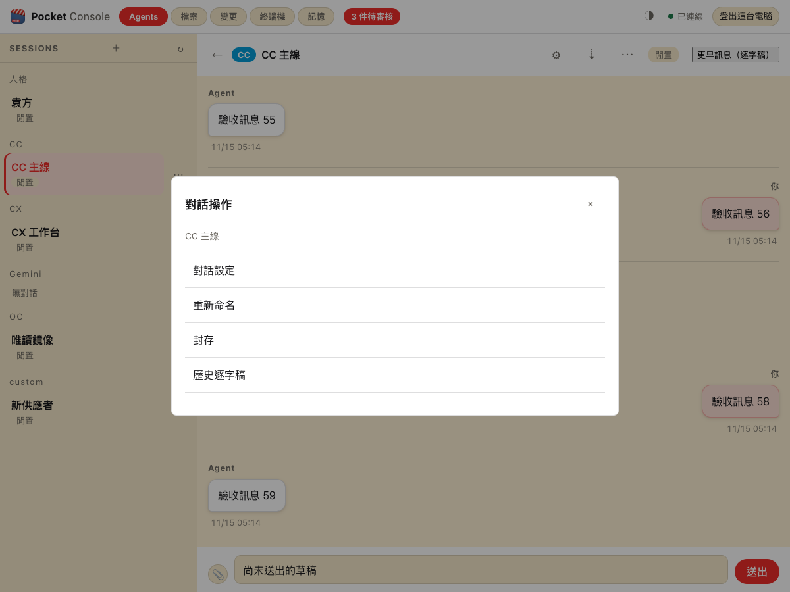
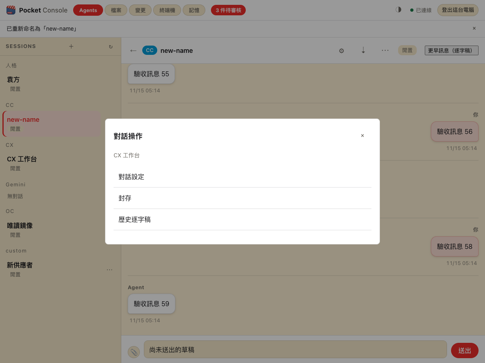
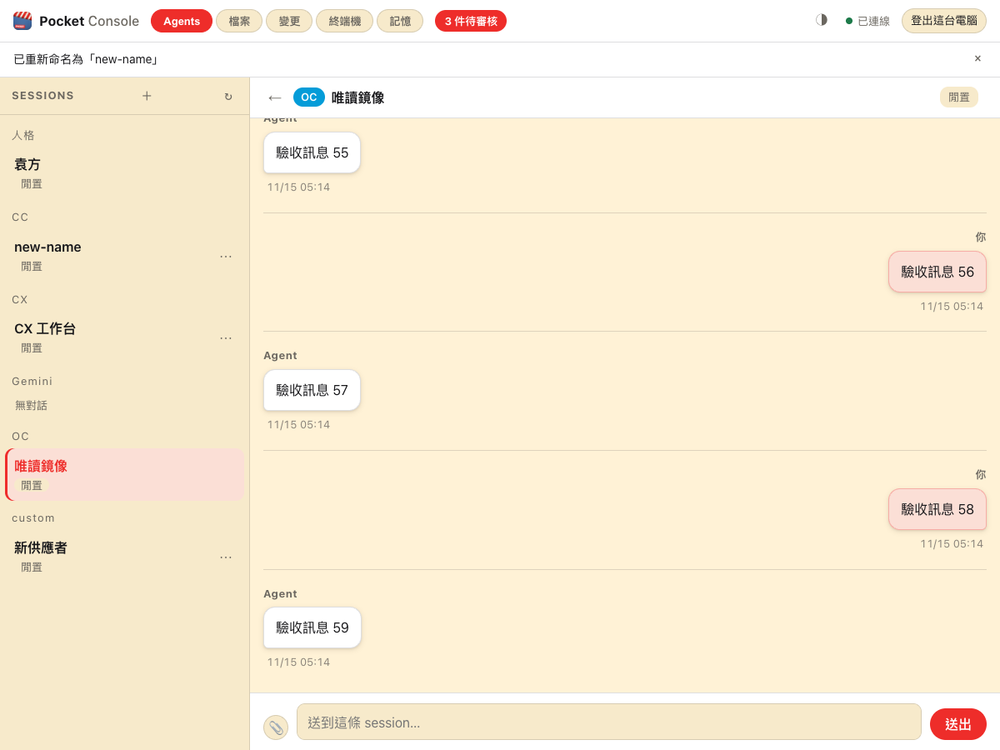
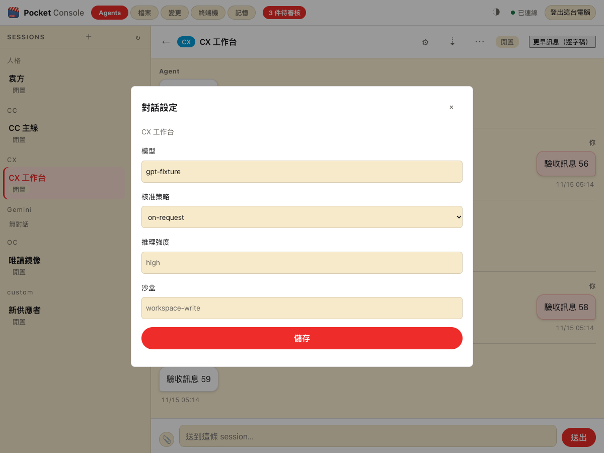
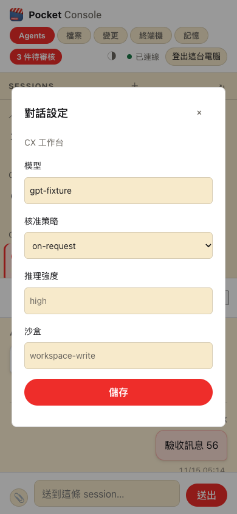
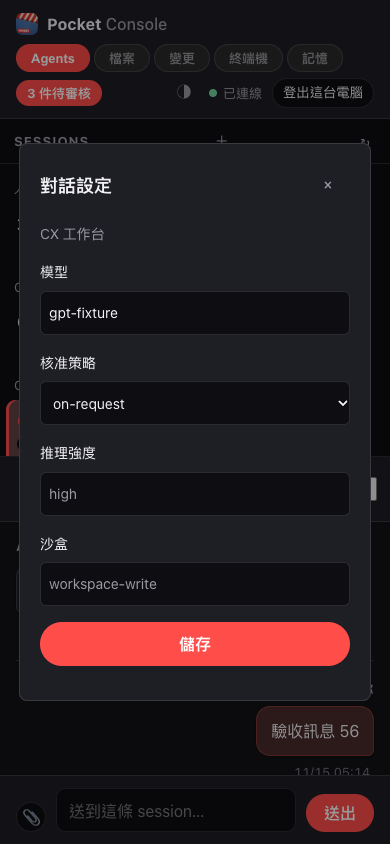
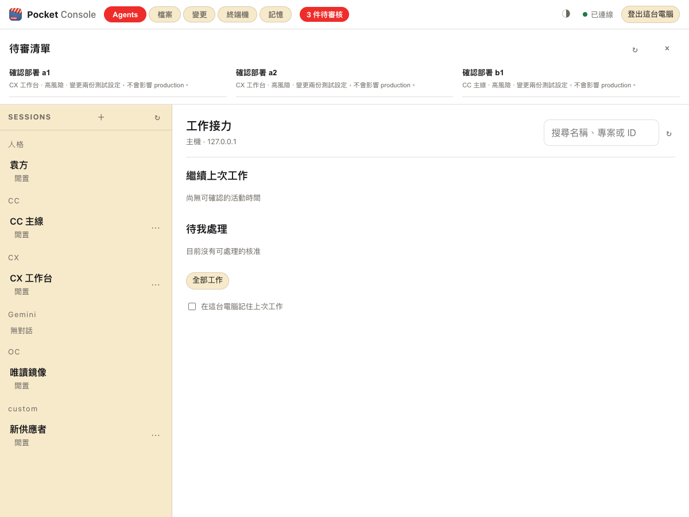
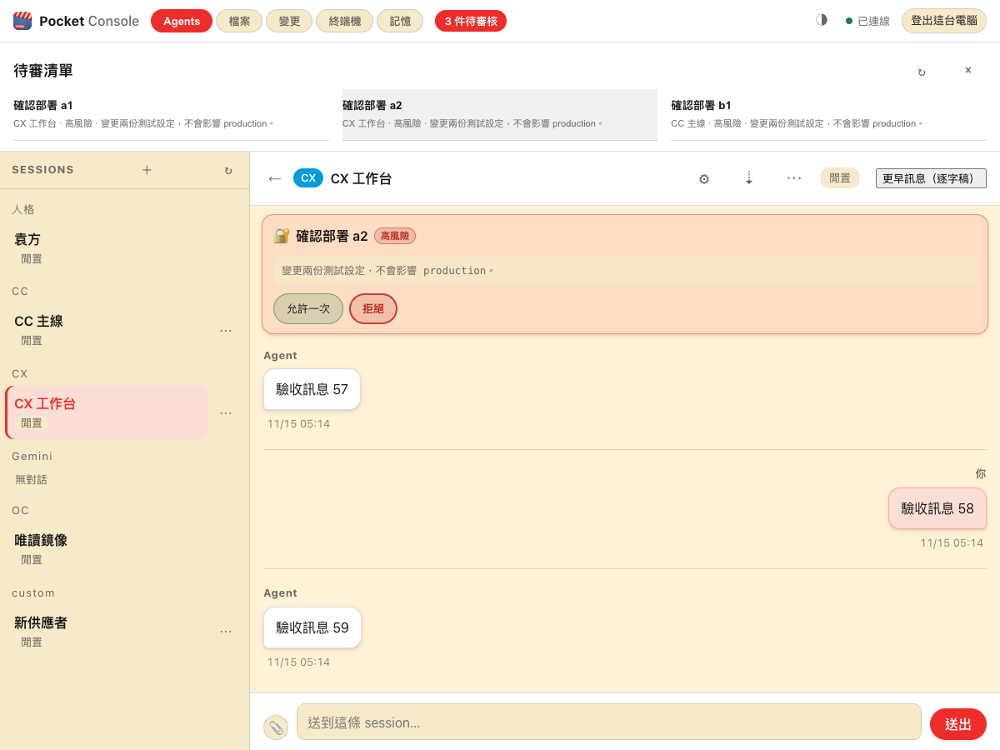
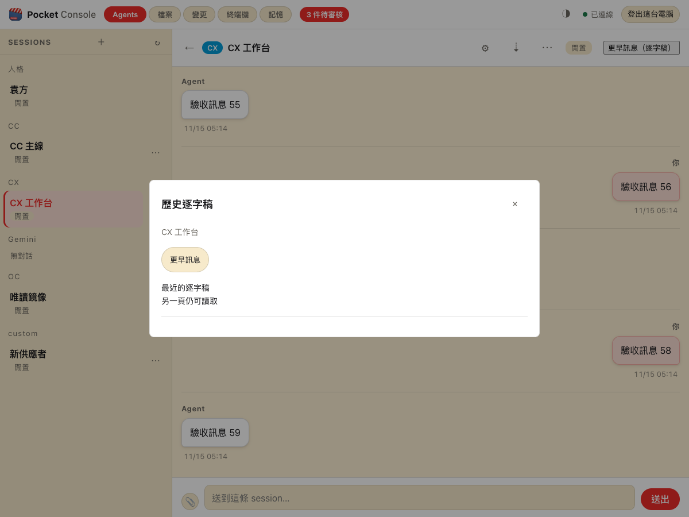
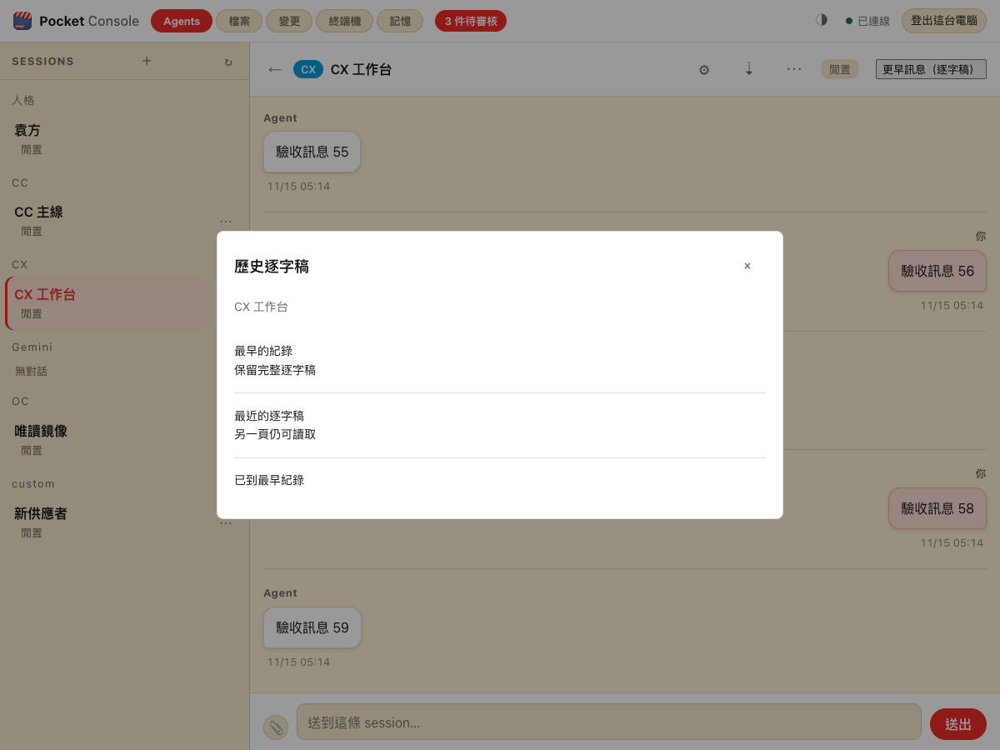

# Console W2 驗收交接

日期：2026-11-18
分支：`feat/console-w2-ops`
基底：`10f04f5`，包含 P0 capability/approval 修正。
程式提交：`71caeec`。本文件與契約、算圖另行提交。

本輪依 `docs/CONSOLE_W2_BRIEF.md` 完成 1-7。只提交並推送 feature branch，
沒有合併 main、重啟服務、啟動 bridge 或寫入 production DB。

## 已完成

| 項目 | 實作及驗收 |
| --- | --- |
| rename | 列表操作選單；更名回傳新 ID 時同步切換、保留未送草稿；不支援者隱藏 |
| archive | 先確認，再封存；提供持續存在的取消封存操作；復原失敗可重試 |
| config | 欄位由主機 schema 決定；Codex model/approval_policy 可寫，effort/sandbox 唯讀；CC2 讀 meta，OpenCode 讀動態選項 |
| compact | 依主機能力提供；只有明確 USE_CC_COMPRESS 才轉既有 CC 入口；不把請求收據說成完成 |
| history | ring 耗盡/409 後打開逐字稿分頁；text/cursor 與 messages/offset 皆支援；不改 live 卡片與 SSE 游標 |
| read cursor | 聚焦、可見、貼底且快照有效時送出；400ms 合併，時間戳高水位去重；同步手機事件；背景及借用機不送 |
| approval hub | 按 approval 物件計數、分頁，支援一條 session 多筆待審；沿用 P0 的 detail/risk/danger/multiselect 渲染 |

每個新 op 都經 `canUse`。前端沒有新增 provider-name 分支，供應者矩陣來自
`/app/v2/providers/capabilities`。未知能力維持本機 fail-open/hide-only；
借用機仍採原本授權白名單，不存取全域 hub 或能力矩陣。

## 查證後調整

1. 交辦提及的 Codex effort/sandbox 實際仍是 spawn-only。UI 呈現唯讀，不送無效修改。
2. read endpoint 只接受 Hermes persona，不支援 coding session。本輪沒有虛構 CX/CC 已讀能力。
3. CardStore seq 與全域事件 seq 不同，因此已讀只送 last_read_ts/message_id，絕不送 card latest_seq。
4. Provider 逐字稿和卡片 ID 不同，獨立呈現完整歷史，不強行合併，避免重複回放。
5. Codex 多題問答沿用同一 approval ID。hub 改讀即時題目與 q_index，保留 danger 正規字彙；next_question 不結案。
6. not_resumable/none 顯示不能作答；CC 複選只允許目前 prompt 對應的 approval。相同題目跨項目不共用勾選。
7. 無 session 或不在目前清單的舊 hub 項目仍顯示原因與內容，但不能從清單導向不存在的對話。

## 瀏覽器實測

直接載入出貨 `index.html`、`app.js`、`ops.js`、CSS，不複製第二份 UI。
本機 HTTP fixture、獨立 Chrome profile、禁用 service worker、阻擋外部請求。
無真實 provider、帳號、模型呼叫或 production 資料。

- W2：9/9 通過。
- 原工作台：2 通過，1 個安裝型 PWA 測試未啟用而跳過。
- P0 Node 行為：29/29 通過，原複選、danger 快捷鍵、即時收卡未退化。
- 新增後端契約：7/7 通過。
- 截圖：1200x900 桌面、390x844 手機；深淺色對話框無超框。

重跑（Playwright 使用暫存目錄安裝，不加入 repo 的依賴）：

```sh
NODE_PATH=/private/tmp/console-w34-qa/node_modules \
POCKET_QA_SCREENSHOTS=docs/console-w2-preview \
node --test tests/browser/console-ops.cjs tests/browser/console-workstation.cjs

node --test tests/console_approval_p0.test.cjs
PYTHON=~/apps/hermes-agent/runtime/venv/bin/python scripts/run-tests.sh
```

完整逐檔 runner 跑了兩輪（每輪 218 檔）：

| 執行 | 原始結果 | 說明 |
| --- | --- | --- |
| 第一輪 `bridge-tests-kGYJba` | 216 綠 / 2 紅 | P0 fixture 的來源切點註解被移名；已修復並補跑通過。另一紅為已知 persona_description。 |
| 第二輪 `bridge-tests-ciDRKM` | 215 綠 / 3 紅 | 即時題目 overlay 的 style 正規化、IME guard 靜態掃描位置、已知 persona_description。前兩項已修復。 |
| Codex 補跑 `bridge-tests-Jepyq9` | 1 檔綠 / 0 紅 | `test_codex_server_requests` 全部 45 tests 通過；不是忽略失敗或改測試斷言。 |
| Console 補跑 `bridge-tests-GNZ5SR` | 16 檔綠 / 0 紅 | 包含 P0、CJK、W2 契約、登入/授權/歷史/遠端範圍等。 |

依最終補跑結果：218 檔中 217 檔通過，僅剩交辦明列的
`test_persona_description`（3 tests：2 failures、1 error）。問題分別為
description 欄位仍出現、重複人格回 400 非 409、測試 profile alias 目錄不存在。
本輪沒有改動該功能。沒有將「補跑後 217 綠」偽稱成單次全套原始結果。

新增修改造成的兩個回歸都已修復：live options 保持 `deny -> danger` 契約，
快捷鍵的 Enter 路徑保留明確 IME guard。棘輪通過，沒有更新 baseline；
JavaScript 語法、Python py_compile、`git diff --check` 通過。
完整輸出位於本機 `$TMPDIR/bridge-tests-*`；不將暫存 log 或機器狀態加入 repo。

## 算圖

### 支援與限制





### 設定





### 多筆審批




### 歷史接續




## 變更檔案

- `bridge.py`：additive 能力欄位、hub 即時問答序列化，沒有變更操作權限或 provider 執行入口。
- `static/console/ops.js`：新操作、逐字稿、hub、已讀發送邏輯。
- `static/console/app.js`：能力閘與生命周期掛接、P0 選中 approval 對接、對話框鍵盤隔離。
- `static/console/index.html`、`style.css`：操作入口、對話框、hub、通知區。
- `static/console/sw.js`：cache v16 並納入 ops.js。
- `tests/browser/console-ops.cjs`、`fixtures/workstation.cjs`：離線 API 驗收。
- `tests/test_console_ops_contract.py`：後端契約守門。
- `tests/console_approval_p0.test.cjs`、`test_console_approval_p0.py`：測試 harness 掛接更新，保留原斷言。
- `docs/APP_BRIDGE_CONTRACT.md`、本目錄：契約、驗收與算圖。

## 整合提醒與限制

W4 已推 `feat/console-w4-mobile` (`5a99886`)，W3 已推
`feat/console-w3-state` (`82bb0f3`)。本輪沒有合併它們。
之後整合 `app.js` 時保留 W4 的 `.sess` button/鍵盤可達性，將 W2 溢出鈕放在
外層 `.session-row`，不要形成 button 裡包 button。W3 的預覽/未讀/狀態 dispatch
須與 W2 `onEvent` 並存；read_cursor 接收端不要把 cardring seq 當事件 seq。

第 8 項 roster 屬 W3，沒有在此重做。選做第 9 項 key/media/legacy CC model-mode
未擴張。未做 production live smoke，因本輪明令禁止啟動 bridge 或 production
寫入；部分唯讀外觀 API（例如 approvals GET）內部也可能做過期清理，故不呼叫。
尚未驗證真實 provider 的新 UI 全流程與實際安裝 PWA，須於核准部署後再驗。
